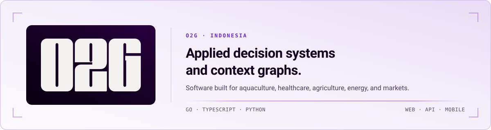

  <picture>
    <source media="(prefers-color-scheme: dark)" srcset="./assets/hero-dark.svg">
    
  </picture>

  <strong>O2G</strong> is an Indonesian engineering collective building applied decision systems, context graphs, and field software across aquaculture, healthcare, agriculture, energy, industrial supply chains, and capital markets.

  <a href="https://github.com/orgs/O2G-Main/repositories">Repositories</a>
  &nbsp;&middot;&nbsp;
  <a href="https://github.com/orgs/O2G-Main/people">People</a>
  &nbsp;&middot;&nbsp;
  <a href="https://github.com/O2G-Main/.github">Profile Source</a>

<picture>
  <source media="(prefers-color-scheme: dark)" srcset="./assets/divider-dark.svg">
  
</picture>

## Multi-Service Platforms

Core products split across dedicated backend engines, web consoles, and mobile clients.

| Platform | Focus | Repositories | Stack |
| :--- | :--- | :--- | :--- |
| **AquaSeq** | Shrimp pond health decision support combining eDNA qPCR and water chemistry scoring with offline-capable field observation (GenoHack 2026) | [`AquaSeq-back`](https://github.com/O2G-Main/AquaSeq-back), [`AquaSeq-front`](https://github.com/O2G-Main/AquaSeq-front) [`AquaSeq-Mobile`](https://github.com/O2G-Main/AquaSeq-Mobile), [`AquaSeq-Explaination`](https://github.com/O2G-Main/AquaSeq-Explaination) | Go, Next.js, TypeScript, Expo |
| **Pantara** | Collaborative team workspace designed to help teams distribute and balance workloads sustainably | [`PANTARA-BACK`](https://github.com/O2G-Main/PANTARA-BACK), [`PANTARA-v1`](https://github.com/O2G-Main/PANTARA-v1) [`Pantara`](https://github.com/O2G-Main/Pantara) | Go (chi, pgx, Redis), Next.js, Python |
| **MilkGraph** | Dynamic dairy receiving flow, end-to-end volume traceability, and context-graph simulation for milk processing (PLAY IT! PLUS 2026) | [`Milkgraph`](https://github.com/O2G-Main/Milkgraph), [`Milkgraph-Back`](https://github.com/O2G-Main/Milkgraph-Back) | Next.js, TypeScript, Go, PostgreSQL |

## Context Graphs and Intelligence

Systems that connect fragmented operational records into queryable graphs and risk views.

| Project | What It Does | Links | Stack |
| :--- | :--- | :--- | :--- |
| **Tessera** | Customer churn early-warning graph unifying CRM, billing, support, usage, and interaction signals for account teams | [Repository](https://github.com/O2G-Main/tessera) [Live Demo](https://tessera-xi-swart.vercel.app) | JavaScript, TypeScript, Python |
| **ChainGuard** | Traceability dashboard and IoT logger receiver for chili and shallot agricultural supply chains | [Repository](https://github.com/O2G-Main/chainguard-app) | TypeScript, Next.js, Neo4j |
| **OreLens** | Commodity exposure and company resilience intelligence across IDX coal, gold, nickel, and copper issuers (Sectors Hackathon) | [Repository](https://github.com/O2G-Main/OreLens) | Python (Django/DRF), Next.js, SQLite |

## Applied AI and Field Operations

Focused tools solving operational workflows in clinics, rural energy grids, internal SOPs, and verified learning.

| Project | What It Does | Links | Stack |
| :--- | :--- | :--- | :--- |
| **KapanDok** | Outpatient clinic start-time prediction and WhatsApp arrival re-timing system (UMS Health Innovation Hackathon 2026) | [Repository](https://github.com/O2G-Main/kapandok) | TypeScript, Python, Docker |
| **SuryaJaga** | Early-warning monitoring prototype keeping rural solar microgrids (PLTS desa) operational (Seno Hackathon ITS 2026) | [Repository](https://github.com/O2G-Main/SURYAJAGA) [Live Demo](https://suryajaga.vercel.app) | Next.js, TypeScript, FastAPI |
| **SOPia** | Conversational SOP assistant that surfaces matching policy clauses, step sequences, and human approval checkpoints | [Repository](https://github.com/O2G-Main/SOPia) | Python, TypeScript |
| **Progressio** | Career-path learning platform turning diagnostics and skill assessments into SHA-256 verifiable credentials | [Repository](https://github.com/O2G-Main/Progressio) | Python, JavaScript, Flutter (Dart) |

<picture>
  <source media="(prefers-color-scheme: dark)" srcset="./assets/divider-dark.svg">
  
</picture>

## Stack and Engineering Approach

  
  
  
  
  
  
   
  
  
  
  

- **Deterministic logic before model layers:** Risk scoring, threshold gating, and curriculum rules are kept explicit and testable in Go or Python before layering inference or guidance on top.
- **Clear API boundaries:** Backend engines expose typed JSON and OpenAPI contracts consumed independently by Next.js dashboards and mobile clients.
- **Designed for field constraints:** Interfaces support low-friction channels such as WhatsApp notifications, rule-based offline fallbacks, and lightweight container deployments.

<picture>
  <source media="(prefers-color-scheme: dark)" srcset="./assets/divider-dark.svg">
  
</picture>

  <strong>O2G</strong> &middot; Indonesia &middot; <a href="https://github.com/orgs/O2G-Main/repositories">Browse all repositories</a>

